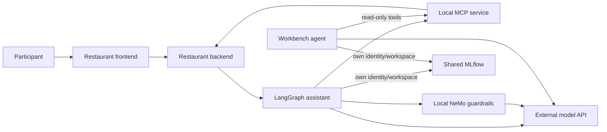

# How the restaurant lab works

This document explains the deployed infrastructure and connections. For the
attendee exercises and schedule, use [the application workshop](https://github.com/Kounex/tableschnappi/blob/main/workshop/README.md).
Each participant `userN` owns project
`tableschnappi-userN`. Demo login credentials match: for example,
username `user1`, password `user1`.

| Each participant gets | Shared across the event |
|---|---|
| Restaurant frontend, backend and synthetic state | OpenShift AI operator/dashboard |
| LangGraph assistant, MCP service, NeMo guardrails | Operator-managed MLflow server |
| Jupyter workbench, service accounts, 5 GiB notebook PVC | PostgreSQL metadata, S3 artifacts, image builds |
| MLflow workspace, experiments, prompt versions and traces | External model API, upstream key and quota |

These services run separately in each participant project. User1's prompt,
policy or reservation changes do not affect user2. Restaurant data is in memory
and resets when its backend restarts.

## Model configuration and AI assets

`config/site-values.yaml` supplies endpoint/model values to the pinned Helm
chart. The application and NeMo use the namespace's `Secret/endpoint-api-key-1`,
key `api_key`, and call the external model API directly. The final agent
notebook uses the same endpoint/model Secret and read-only MCP
service directly. It runs a separate agent; the restaurant's NeMo shield is not
in that notebook's model path.

The unused AI asset registration is disabled in the lab. There is no separate
model discovery entry, local inference deployment or MaaS/Kuadrant gateway in
this application path. The OpenShift AI project discovery label
`opendatahub.io/dashboard: "true"` remains in
`manifests/30-participant/project/namespace.yaml`.

## Platform model catalog

Open **AI hub → Models → Catalog** to browse the configured model sources.
`manifests/00-platform/datasciencecluster.yaml` manages the `modelregistry`
component and selects `rhoai-model-registries`; `model-catalog.yaml` explicitly
sets the dashboard's `disableModelCatalog: false`. The platform access YAML
binds the catalog read role to `system:authenticated`, so all normal users can
browse it. Catalog source administration remains separate. The operator provides the
catalog server, its PostgreSQL cache and registry controller. The catalog cache
uses `emptyDir` in this release. The lab also declares one separate `ModelRegistry/summit-connect`, backed by its
operator-created PostgreSQL deployment and 5 GiB PVC. The registry-user RoleBinding
grants `system:authenticated` access to that shared registry. Users can register
and change the same model metadata there; MLflow's per-namespace workspaces are
separate. The native demo database is not HA; deleting the registry deletes its
owned data volume. See the [configuration](INSTALL.md#shared-model-registry).

The restaurant's external endpoint and model name are configured through its
Helm values and model Secret, as described above.

## One MLflow server, separate workspaces

Each workspace maps to a namespace. The assistant and workbench authenticate
with dedicated service accounts and use their own namespace as `MLFLOW_WORKSPACE`.
Namespace RoleBindings grant MLflow integration permissions; the human and
workbench also have local `edit` for exercises. MLflow checks namespace access;
changing the workspace value alone cannot grant access to another participant.
Administrators can access all workspaces. The database/bucket remain shared.

In the application chart's `charts/tableschnappi/templates/workbench/notebook.yaml`,
Notebook **top-level `metadata.annotations`** contains `opendatahub.io/mlflow-instance: mlflow`.
The main notebook container has the same name as the Notebook, as required by
the native controller. OpenShift AI injects MLflow connection/authentication configuration. The
annotation does not instrument arbitrary code. Workbench code still needs the
MLflow SDK, autologging or explicit traces.

## Workshop ownership

The application repository owns the
[attendee walkthrough](https://github.com/Kounex/tableschnappi/blob/main/workshop/README.md),
[agent notebook](https://github.com/Kounex/tableschnappi/blob/main/workshop/agent-playground.ipynb)
and [instructor guide](https://github.com/Kounex/tableschnappi/blob/main/docs/INSTRUCTOR.md).
This runbook prepares their projects, images, configuration and permissions.
It does not maintain a second copy of the schedule or exercises.

The workbench's independent agent logs to `restaurant-agent-playground`;
restaurant traces remain in `restaurant-chatbot-traces`. Both use the same
namespace-authorized MLflow workspace. The pinned source archive and prepared
workbench image must match the desired workshop revision. Existing PVC content
is preserved on upgrades; use the explicit participant reset when a clean source
checkout is intended.

## Limitations

Restaurant/staff URLs retain the fork's unauthenticated demo behavior; use
synthetic data. Guardrails fail open on errors. Some model/tracking TLS checks
are disabled by the current application/workshop configuration; storage verifies
the service CA. PostgreSQL is a single lab Deployment with no database operator,
HA or automatic backup. The real `user1` SSO and functional rehearsal pass;
simultaneous load and full fresh-platform replay remain [validation gates](VALIDATION.md).
