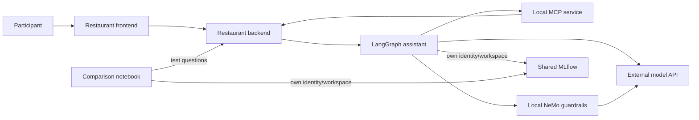

# How the restaurant lab works

The one-hour exercise is **chat → inspect MLflow → change a prompt or guardrail
→ repeat and compare**. Each participant `userN` owns project
`tableschnappi-userN`. Demo login credentials match: for example,
username `user1`, password `user1`.

| Each participant gets | Shared across the event |
|---|---|
| Restaurant frontend, backend and synthetic state | OpenShift AI operator/dashboard |
| LangGraph assistant, MCP service, NeMo guardrails | Operator-managed MLflow server |
| Jupyter workbench, service accounts, 5 GiB notebook PVC | PostgreSQL metadata, S3 artifacts, image builds |
| MLflow workspace, experiments, prompt versions and traces | External model API, upstream key and quota |



These services run separately in each participant project. User1's prompt,
policy or reservation changes do not affect user2. Restaurant data is in memory
and resets when its backend restarts.

## Model configuration and AI assets

`config/site-values.yaml` supplies endpoint/model values to the pinned Helm
chart. The application and NeMo use the namespace's `Secret/endpoint-api-key-1`,
key `api_key`, and call the external model API directly. The comparison notebook
calls the restaurant API, not the model directly.

The unused AI asset registration is disabled in the lab. There is no separate
model discovery entry, local inference deployment or MaaS/Kuadrant gateway in
this application path. The OpenShift AI project discovery label
`opendatahub.io/dashboard: "true"` remains in
`manifests/30-participant/project/namespace.yaml`.

## Platform model catalog

Open **AI hub → Models → Catalog** to browse the configured model sources.
`manifests/00-platform/datasciencecluster.yaml` manages the `modelregistry`
component and selects `rhoai-model-registries`; `model-catalog.yaml` explicitly
sets the dashboard's `disableModelCatalog: false`. The platform access YAML
binds the catalog read role to `system:authenticated`, so all normal users can
browse it. Catalog source administration remains separate. The operator provides the
catalog server, its PostgreSQL cache and registry controller. The catalog cache
uses `emptyDir` in this release. Individual model registry instances are a
separate operation.

The restaurant's external endpoint and model name are configured through its
Helm values and model Secret, as described above.

## One MLflow server, separate workspaces

Each workspace maps to a namespace. The assistant and workbench authenticate
with dedicated service accounts and use their own namespace as `MLFLOW_WORKSPACE`.
Namespace RoleBindings grant MLflow integration permissions; the human and
workbench also have local `edit` for exercises. MLflow checks namespace access;
changing the workspace value alone cannot grant access to another participant.
Administrators can access all workspaces. The database/bucket remain shared.

In the application chart's `charts/tableschnappi/templates/workbench/notebook.yaml`,
Notebook **top-level `metadata.annotations`** contains `opendatahub.io/mlflow-instance: mlflow`.
The main notebook container has the same name as the Notebook, as required by
the native controller. OpenShift AI injects MLflow connection/authentication configuration. The
annotation does not instrument arbitrary code. Workbench code still needs the
MLflow SDK, autologging or explicit traces.

## What the application records

The Python assistant has its own MLflow instrumentation:

| Code | Records |
|---|---|
| `@mlflow.trace` around `run_assistant()` | The entire chat turn |
| `mlflow.langchain.autolog()` | Nested graph nodes and supported model calls |
| Manual `TOOL` span around MCP HTTP calls | Tool arguments, results and duration |

The model selects tool calls; the assistant executes them through the local MCP
service, which reads/updates that project's restaurant backend. Guard spans
capture the guard's result and duration. Backend/MCP internals and NeMo's own
internal model request are not separately instrumented.

## Participant flow

The one-hour schedule, question cards and learning goals are in
[LAB.md](LAB.md). The following flow uses the application chart's workshop profile.

1. Sign in as `userN`; open the restaurant, matching MLflow workspace and workbench.
2. Predict tool use for the three starter questions, chat, and inspect the model/tool spans in `restaurant-chatbot-traces`.
3. Rate an answer and find its persisted `user_rating` feedback on the trace.
4. Run the guided notebook's baseline batch **before** changing the prompt.
5. In MLflow, create/compare a `restaurant-assistant-prompt` version and move `active` to it. This text is the restaurant agent's system prompt. Its next turn uses the selected version; code-enforced reservation checks remain in place.
6. Repeat a chat, inspect its prompt version, then run the same five-case candidate batch. The notebook sends requests to the restaurant API; the LangGraph agent continues to execute in the restaurant stack.
7. Compare answers and traces, then restore the baseline prompt. Complete the guardrails exercise: observe an allowed/off-topic pair, edit the NeMo policy, restart/warm it, and repeat both requests while holding the prompt fixed. Inspect the changed guard/agent trace paths.
8. Restore the baseline prompt/policy and start a New chat. Keep the MLflow evidence.

The guided `comparison.ipynb` and concise attendee guides live in
[the application workshop](https://github.com/Kounex/tableschnappi/tree/main/workshop).
The pinned workshop profile loads `@active`; publishing a new version alone
does not activate it.

`01-own-agent-mcp.ipynb` runs an independent model/MCP loop inside the workbench,
logging to `own-agent-mcp-example`. Editing that example does not automatically
change the restaurant assistant. It and the additional pipeline/RAG examples
are outside the core lab.

## Guardrail warmup

The lab profile connects shields and starts NeMo with an empty input policy.
Warm/check that baseline from the repository root:

```bash
bash scripts/warm-guardrails.sh 1 1
```

After applying the workshop's blocking policy and restarting NeMo:

```bash
bash scripts/warm-guardrails.sh --expect-blocked 1 1
```

Restore the original empty policy/restart, then warm without `--expect-blocked`.
The Job sends allowed/off-topic requests to NeMo, with a longer cold-start timeout.
A real restaurant request and trace inspection still verify the entire path.

## Limitations

Restaurant/staff URLs retain the fork's unauthenticated demo behavior; use
synthetic data. Guardrails fail open on errors. Some model/tracking TLS checks
are disabled by the current application/workshop configuration; storage verifies
the service CA. PostgreSQL is a single lab Deployment with no database operator,
HA or automatic backup. The real `user1` SSO and functional rehearsal pass;
simultaneous load and full fresh-platform replay remain [validation gates](VALIDATION.md).
